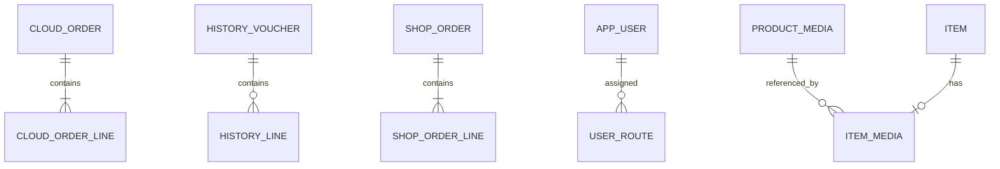

# Saarthi database field reference

Companion to the [low-level design](low-level-design.md). PostgreSQL entries describe the source schema after migrations. SQLite entries were checked against the two local files. Table presence in production depends on applied migrations. No live PostgreSQL metadata or business rows were queried.

## How to read the fields

- A **primary key** identifies one row. A **composite key** uses several fields together. A **foreign key** is an enforced relationship. A **logical link** is a relationship the application uses, such as the same order number in different databases.
- **PostgreSQL** uses typed columns including fixed-precision decimal amounts (`NUMERIC`), booleans, timestamps, structured JSON (`JSONB`), and binary data (`BYTEA`). A `TIMESTAMPTZ` represents an instant. A plain `TIMESTAMP` carries no time zone.
- **SQLite** uses declared types such as `TEXT`, `INTEGER`, `REAL` and `BLOB`. This project stores most local timestamps and business dates as text and many amounts as `REAL`. Some dates are compact strings such as `YYYYMMDD`. Desktop target amounts are stored as decimal text.
- A **GUID** identifies a Tally object. An **AlterID** identifies its observed version. A **voucher number** is the number people see in Tally. An **order number** identifies a Saarthi order. A **request ID** identifies a specific submission and is used to resolve a retry.

The order number connects cloud and local order copies. The Tally GUID connects a billed order to voucher observations. Those links cross ownership boundaries. A browser submission UUID is separate from both.

## PostgreSQL · cloud service

### Orders and billing

| Table and key | Fields and meaning |
| --- | --- |
| `cloud_order` · `order_no` | **Identity and context:** `order_no` is the server-assigned reference, `created_at` is submission time, `salesperson` is the account email, `customer_guid` identifies the customer or pending prospect, `customer_name` and `route` are copied context, `prospect_id` preserves the original prospect link. **Commercial data:** `subtotal`, `gst`, `total`, `note`, and `stock_asof` at order time. **Fulfilment:** `status`, `pulled_at`, `tally_guid`, `tally_vchno`, `completed_at`. **Retry and retention:** `client_request_id`, `request_fingerprint`, `retry_protected`, `retention_hold`. Non-null request IDs are unique per salesperson |
| `cloud_order_line` · `(order_no, line_no)` | `order_no` references the header and cascades on deletion. `line_no` is position. `item_guid`, `item_name` and `unit` identify and describe the product at submission. `qty`, `rate` and `amount` are submitted quantity, quoted rate and calculated line total |
| `order_receipt` · `(salesperson, client_request_id)` | `salesperson` and `client_request_id` identify the original submission. `request_fingerprint` identifies its contents, `order_no` stays unique, `tally_guid` links the invoice when known, `response` is the compact saved JSON reply, and `archived_at` records when it was archived |
| `history_voucher` · `guid` | `guid` identifies the Tally voucher, `party` is customer name, `vdate` is voucher business date, `vchtype` is voucher type, `number` is Tally’s visible number, and `amount` is its published amount. `source_alterid`, `source_state` and `observed_at` record version, state and observation time. `retention_hold` protects detail |
| `history_line` · `(voucher_guid, line_no)` | `voucher_guid` references the voucher header and cascades on deletion. `line_no`, `item`, `qty`, `unit`, `rate` and `amount` describe the current published item line |

The original order total and the Tally voucher amount can diverge after billing. Follow the order's `tally_guid` to the published voucher to see the accounting result.

### Catalogue, customers and derived data

| Table and key | Fields and meaning |
| --- | --- |
| `item` · `guid` | **Catalogue:** `guid`, `name`, `grp` product group, `unit`, `rate` reference rate and `mrp`. **Stock:** `on_hand` observed stock, `saleable` published availability figure, `stock_asof` observation time. **Derived:** `daily` estimated units sold per day and `cover_days` estimated days of cover. **Optional:** `brand`, `category`, `pack_size`, `scheme`. Some optional fields may be empty in the published data |
| `customer` · `guid` | **Identity:** `guid`, `name`, `route`, `state`, `gstin`. **Balance:** `outstanding`, `balance_asof`. **Activity:** `aov` average order value, `last_days` days since last sale, `churn`, `growth`, `trend` serialized trend. **Ageing:** `overdue`, `overdue_days`, buckets `d0_30`, `d31_60`, `d61_90`, `d90_plus`, `ageing_gap` reconciliation difference, `last_receipt`. **Contact/credit/location:** `phone`, `contact`, `email`, `credit_limit`, `credit_days`, `address`, `lat`, `lng` |
| `party_rate` · `(party, item)` | Customer and item names, `last_rate` last observed rate, `last_date` date of that rate, `times` observations, `item_median` reference median across customers |
| `party_buy` · `(party, item)` | Customer and item names, `cyc_lo` and `cyc_hi` estimated reorder interval bounds, `last_days` since purchase, `typical_qty`, `freq_n` bills containing the item, `freq_m` bills considered, and `is_core` regular-buy flag |
| `daily_sales` · `(vdate, party, salesperson)` | Business date, customer name and salesperson attribution when available, plus `invoices` count and `amount` total |
| `owner_purchase_rate` · `guid` | Product `guid` references `item`. `rate`, `unit`, `vdate`, `voucher_guid`, `source_alterid` identify the published purchase-derived cost and its source version. The website exposes this to the authorized owner role |
| `sync_status` · `id` fixed to 1 | `company` identifies the published company, `stock_asof` is last stock observation, `voucher_watermark` is the observed voucher checkpoint, `pushed_at` is last push time. `orders_waiting`, `oldest_wait_mins`, `orders_set_aside`, `invoice_blocked_since`, `invoice_error` describe billing health |

### Identity, visits and media

| Table and key | Fields and meaning |
| --- | --- |
| `app_user` · `email` | Allowlisted Google account email, `name`, `role` (admin or salesperson), `active` access switch |
| `user_route` · `(email, route)` | Account email references `app_user` and cascades on deletion, `route` is its assignment |
| `prospect` · `id` | `id`, `name`, `route`, `phone`, `address` and `note` identify the proposal. `proposed_by` references `app_user`, `created_at` records submission. `status`, `decided_by`, `decided_at`, `decide_note` record approval or rejection. `tally_guid` and `linked_at` record the verified Tally ledger link |
| `desktop_grant` · `code_hash` | Hashed one-time desktop grant, `email` referencing the owner account, `challenge` for the exchange, `expires_at`, `used_at` |
| `sales_visit` · `(salesperson, vdate, customer_guid)` | Account, India business date and customer identity form the deduplication key. `customer_name` and `route` capture context, `visited_at` is the visit timestamp, `pulled_at` records agent pickup |
| `product_media` · `digest` | Content hash, `mime` image format, `body` binary image |
| `item_media` · `guid` | `guid` references the product. `digest` references the image. Several products can share one image |

Sources: [Main PostgreSQL schema and migrations](../../cloud_db.py), [visit schema](../../sales_visits.py), [media schema](../../product_media.py), [owner rate schema](../../purchase_costs.py).

## SQLite · Tally archive (`tally_raw.db`)

### Source records, observations and control

| Table and key | Fields and meaning |
| --- | --- |
| `voucher` · `(guid, alterid)` | Tally identity and version. `vchtype`, `vdate`, `party`, `amount` expose key fields. `blob` contains compressed record data. `fetched_at` records when the version was observed |
| `voucher_raw` · `(guid, alterid)` | Voucher identity/version, `vdate`, `vchtype`, compressed full archive `blob`, and `fetched_at` |
| `master` · `(objtype, guid, alterid)` | Tally object type, ID and version, plus `name`, `parent` group, compressed `blob`, and `fetched_at` |
| `deleted_voucher` · `guid` | Voucher ID, `last_seen` version, and `detected_at` deletion observation |
| `deleted_master` · `(objtype, guid)` | Object type and ID, `name`, `last_seen` version, and `detected_at` deletion observation |
| `archived_day` · `vdate` | Archived business date, `vouchers` observed count, `expected` expected count, `bytes` archive size, and `fetched_at` |
| `stock_snapshot` · `(observed_at, guid)` | Observation time and item identity, plus `name`, `qty`, `unit` and `rate` from the observation |
| `party_balance` · `(observed_at, guid)` | Observation time and ledger identity, `name` and `closing` balance |
| `sync_state` · `key` | `value` holds a company binding, checkpoint, job bookkeeping or other persisted sync state according to the key. Example keys include `company` and `voucher_alterid` |

### Local order queue and sales facts

| Table and key | Fields and meaning |
| --- | --- |
| `shop_order` · `order_no` | `order_no`, `created_at`, `party_guid`, `party_name`, `route`, `status`, `subtotal`, `gst`, `total`, `stock_asof`, `note` and `prospect_id` carry the order and queue context. `tally_guid` and `tally_vchno` record the verified invoice. `invoice_error`, `invoice_tries`, `invoice_tried_at` record attempts |
| `shop_order_line` · `(order_no, line_no)` | Parent order and line sequence, `item_guid`, `item_name`, `unit`, `qty`, `rate`, and `amount` |
| `shop_excluded_customer` · `name` | Name excluded from the sales-customer projection, `why` for the reason, and `added` for when it was entered |
| `item_invoice_rate` · `item` | Item name, `last_date`, `last_rate`, `voucher_guid`, and `source_alterid` for the latest confirmed sales reference rate |
| `party_item_rate` · `(party, item)` | Customer and item names, `last_date`, `last_rate`, `times`, and `item_median`. Source for the cloud `party_rate` facts |
| `item_metric` · `guid` | Item ID, `name`, `daily` sales velocity, `cover_days`, `last_sold`, `times_sold`, and `computed_at` |
| `party_ageing` · `party` | Customer name, `outstanding` reconstructed amount, `actual` observed balance, `gap` difference, `oldest_days`, buckets `d0_30`, `d31_60`, `d61_90`, `d90_plus`, `last_receipt`, `computed_at` |
| `party_profile` · `party` | Customer name, `aov`, `invoices`, `last_days`, `trend`, `churn`, `growth`, and `computed_at` |
| `party_buy` · `(party, item)` | Customer and item, `cyc_lo`, `cyc_hi`, `last_days`, `typical_qty`, `freq_n`, `freq_m`, and `is_core`. Local source for the cloud buying-pattern table |
| `daily_sales` · `(vdate, party, salesperson)` | Date, customer, salesperson attribution, `invoices` count, and `amount` total |
| `sales_visit` · `(salesperson, vdate, customer_guid)` | Salesperson, business date and customer ID, plus `customer_name`, `route` and `visited_at`. Pickup timestamp stays in the cloud table |

Sources: [Tally archive schema](../../tally_store.py), [local order schema](../../tally_shop.py), [derived data schema](../../tally_insights.py), [local visits schema](../../sales_visits.py).

## SQLite · Windows Admin (`saarthi_admin.db`)

| Table and key | Fields and meaning |
| --- | --- |
| `command` · `id` | Request UUID `id`, operation `kind`, validated JSON text `payload`, lifecycle `state`, `created_at`, `updated_at`, last `error`, and verified JSON text `result` when available |
| `product_image` · `guid` | Product ID, image `mime`, binary `body`, and `updated_at` |
| `inventory_policy` · `guid` | Product ID, reorder `minimum`, optional restock `target`, and `updated_at` |
| `analysis_goal` · `(start, end, route, rep)` | Report date range, route and rep scope identify the sales goal. `amount` is the target stored as decimal text |

Sources: [Admin schema](../../desktop_workflows.py), [sales target schema](../../desktop_analysis.py#L50).

## One invoice across the three stores

| Question | Where to look |
| --- | --- |
| What did the salesperson request? | PostgreSQL `cloud_order` and `cloud_order_line` while retained |
| Did the office collect it? | PostgreSQL `pulled_at` and SQLite `shop_order` under the same order number |
| Which Tally invoice was made? | Local or cloud `tally_guid` and `tally_vchno`, verified against the Tally company |
| Did a later edit change the amount? | Local `voucher` versions and the cloud `history_voucher.source_alterid` and `amount` |
| Can the system resolve a retry after cloud detail cleanup? | PostgreSQL `order_receipt` keyed by salesperson and request ID |
