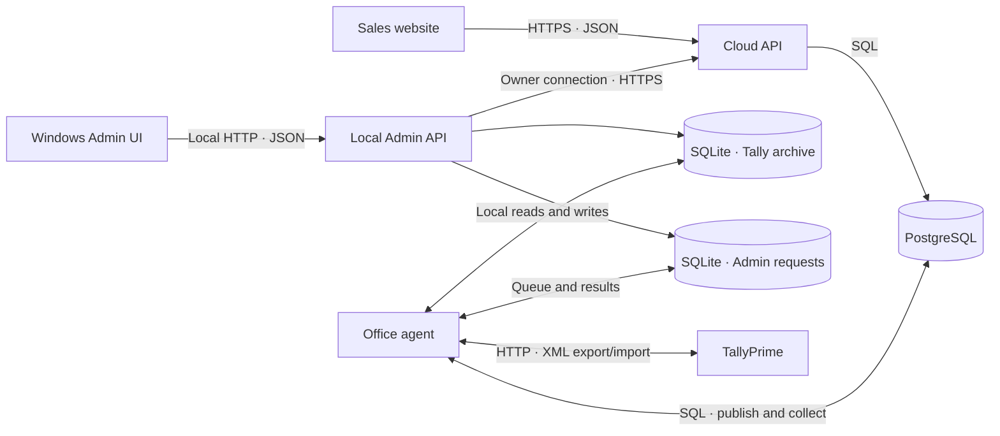
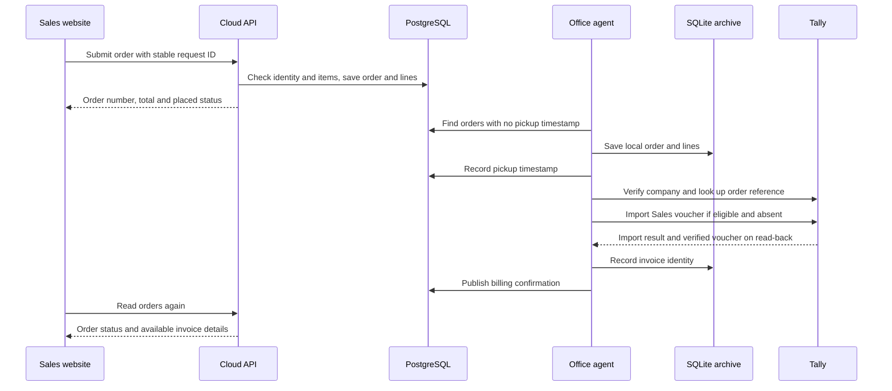
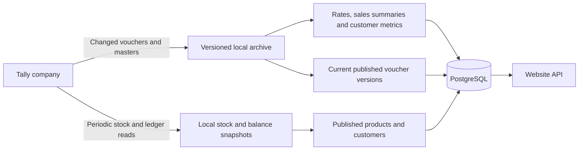

# Saarthi low-level design

Saarthi has two relational database engines. **PostgreSQL** serves the cloud website. **SQLite** stores the Tally archive and Admin requests on the office computer. TallyPrime owns the accounting vouchers. The office agent coordinates the work between these systems.

This guide describes the repository at revision `dac7305`. It covers the operational application and leaves out AI features. The [database field reference](database-fields.md) lists every table and field in scope. Use the sections below to follow the records that move between those tables.

For individual requests and responses, see the [API contract reference](api-contracts.md). For the hosting correction, retention rules and who owns each type of data, see [Hosting, retention and ownership](data-lifecycle.md).

## 1. Who owns what

| Component or store | Where it lives | What it owns or holds |
| --- | --- | --- |
| Sales website | Browser | Forms, displayed data, session cookie, and browser-local drafts and pending submissions |
| Cloud API | Web service at the Railway address used in this chat | Authentication, permissions, validation, order submission, and reads for the website |
| PostgreSQL | Neon in the local project configuration | Submitted orders, user access, shop proposals, visits, and published Tally data for website reads |
| Office agent | Office PC | Scheduled synchronization, pickup, Tally writes, verification, and cloud confirmation |
| SQLite archive, `tally_raw.db` | Office PC | Observed Tally versions, stock and balance snapshots, sync checkpoints, local order queue, and derived metrics |
| SQLite Admin database, `saarthi_admin.db` | Office PC | Desktop requests and results, local images, reorder policies, and sales targets |
| Windows Admin UI and local API | Office PC | Reports, archive browsing, office forms, and control of the local workflow |
| TallyPrime | Office PC or configured Tally host | Accounting company, stock and ledger masters, and the actual invoices and other vouchers |

The local files are embedded databases. The Python process opens them directly. PostgreSQL is a database server the API and agent both connect to. Browser storage is a separate per-device store. A draft saved there is distinct from an order saved in PostgreSQL.

## 2. Website request lifecycle

1. The browser fetches `GET /api/config`, obtains a Google credential when the user signs in, and sends it to `POST /api/auth/google`. The backend verifies the credential and checks the active account in `app_user` before establishing the Saarthi session.
2. On authenticated requests, the backend reads the session and rechecks the account in PostgreSQL. `GET /api/me` returns the account, role and assigned routes. Admin functions enforce the admin role.
3. `GET /api/data` assembles the catalogue, customers, stock and freshness information, payment history and sales data from the cloud database. `GET /api/orders` returns order and invoice information separately. Salespeople see their own orders, filtered to the current India business day in this handler. Admins see recent orders across salespeople.
4. Customer route assignments exist in `user_route`. The current customer-scope helper returns an empty SQL filter, so signed-in users can browse and order for sales customers across routes. Order ownership and admin checks apply separately.

| Request | Main input | Main reads or writes | Response and recipient |
| --- | --- | --- | --- |
| `POST /api/auth/google` | Google credential | Reads account and role, establishes session | Account details and cookie to browser |
| `GET /api/data` | Session | Reads published catalogue, customer and sales data | Data and freshness to website |
| `GET /api/orders` | Session | Reads order headers and lines, joins available invoice facts | Orders and billing information to website |
| `POST /api/orders` | Customer ID, item IDs, quantities, rates, optional note and request ID | Reads customer/items, writes header and lines | Order number, total, line count and state to website |
| `POST /api/orders/ack` | Order number and request ID | Updates retry protection for the matching submission | Acknowledgement result to website |
| `POST /api/visits` | Email, company, customer IDs and visit timestamps | Checks current company/customers, records visit facts | Batch saved result to website |
| `GET /api/product-image/{digest}` | Session and image content ID | Reads published image data | Image bytes to browser |
| `GET /healthz` | HTTP request | Performs a small database check | Success or service unavailable to monitor or caller |

The response to a successful order submission has fields `order_no`, `total`, `lines` (count), `customer`, `status` and `note`. The input fields are `customer_guid`, `lines` (each with `item_guid`, `qty` and `rate`), optional `note` and optional `request_id`. The server supplies the salesperson from the session, and looks up the customer name and item units. The same order number can appear in subsequent reads with a pickup indicator, a voucher number and an invoice object when available.

For troubleshooting, `401` means the protected route lacks a signed-in session. `403` can indicate a disabled account or an admin permission failure. For an order, `422` can indicate invalid request fields, `400` can indicate an item missing from the catalogue, and `409` can indicate a submission ID already used for different contents. Check the response message for the actual cause.

Sources: [Cloud API and session handling](../../api.py), [browser requests](../../web/live.js), [draft persistence](../../web/drafts.js).

## 3. A website order from draft to verified invoice

Use an example order for 10 pieces at ₹992. The sales website sends IDs, quantity and quoted rate. The backend calculates the ₹9,920 line amount. The order and the eventual invoice have separate identities and can differ if the invoice is edited later.

| Step | Record or field to inspect | Rule or failure outcome |
| --- | --- | --- |
| 1. Prepare | Browser draft and submission UUID | The browser retains a pending request on that device so an interrupted response can be resolved using the same request. The backend model still permits an omitted ID for older callers |
| 2. Validate | Customer/item IDs and quantities/rates | Known items, positive quantities/rates, and distinct item IDs are checked. The server calculates line amounts and saves the published stock timestamp. This cloud handler records the order without allocating stock in Tally |
| 3. Commit | `cloud_order` and `cloud_order_line` | One PostgreSQL transaction writes the header and lines. The normal initial state is `placed`. An order linked to a prospect can start as `pending_party` |
| 4. Recover a lost reply | `client_request_id`, `request_fingerprint` | The API serializes retries for the same account/request ID. Same content returns the existing order or archived receipt. Different content under the same ID returns a conflict |
| 5. Pick up | `cloud_order.pulled_at`, `shop_order`, `shop_order_line` | The agent copies unpicked orders directly through SQL. SQLite commits before the enclosing PostgreSQL transaction commits pickup. Repeat pickup uses the same order and line keys so already copied rows are ignored |
| 6. Bill | Order reference, `invoice_tries`, `invoice_error` | The agent verifies the Tally company, checks for an existing voucher using the order reference, imports eligible orders, and reads the resulting invoice back. Order-specific refusals can set an order aside after three tries. A broad Tally refusal can pause the batch and back off |
| 7. Confirm | `tally_guid`, `tally_vchno`, `completed_at` | The agent records the Tally voucher identity locally, then publishes it to the cloud. The order can be confirmed before full invoice details arrive through voucher synchronization |
| 8. Display | Original order lines and available current `history_voucher` and `history_line` | Website refresh can show the original request and the observed accounting result independently |

Three fields answer different support questions. **`pulled_at`** answers whether the office collected it. **`tally_vchno`** identifies the confirmed bill for display. **`source_alterid`** identifies the version of that bill the cloud has observed.

Sources: [Cloud order validation and persistence](../../api.py#L953), [agent pickup](../../tally_cloud.py#L353), [billing and verification](../../tally_invoice.py#L340), [cloud confirmation](../../tally_cloud.py#L497).

## 4. Tally to cloud data synchronization

- **Vouchers and masters.** The agent uses Tally change numbers and saved checkpoints to fetch changes, including edits to older vouchers. The archive retains observed versions by record ID and change number. A separate reconciliation checks for deletions and gaps.
- **Stock and balances.** The agent takes timestamped readings on a separate schedule. A product can sell without the product master getting a new change number. The website displays the published observation and its freshness.
- **Published history.** The agent publishes selected sales-side voucher facts and their lines. Newer observed versions replace cloud facts for the same voucher. Cancelled, optional and deleted states have their own handling. Purchase-voucher details stay in the office archive. A separate owner-only product-cost projection can contain purchase-derived rates.
- **Derived fields.** The local archive rebuilds facts such as recent product/customer prices, sales by day, buying frequency, and estimated ageing. These are calculated from observed records. A later backdated edit can change the derived figures.
- **Retention.** The source defines a seven-day detailed cloud retention policy. An eligible order must be invoiced, picked up, acknowledged and past the completion cutoff, and the job checks the local backup and applies hold protections. A compact `order_receipt` can preserve retry behavior after order details are removed. Voucher history has its own date cutoff and protections. Daily summaries can outlive detailed rows.

| Agent job | Configured interval | What it moves or updates |
| --- | --- | --- |
| Desktop command processing | 15 seconds | Admin queue → Tally → Admin result |
| Voucher sync | 60 seconds | Tally changes → SQLite versions |
| Fast cloud push and pickup | 60 seconds | Catalogue, stock, selected history and confirmations up. Orders and visits down. Approved parties can be processed |
| Billing | 120 seconds | Local order queue → Tally → confirmed result |
| Stock and balances | 5 minutes | Tally observations → SQLite snapshots |
| Masters and derived rates | 15 minutes each | Master changes and local analytics rebuilds |
| Slow publish, retention, and Admin backup | 1 hour each | Wider facts and cleanup, or local backup |
| Archive and reconciliation | 1 day each | More detailed archive and source integrity checks, subject to maintenance rules |

The scheduler checks due jobs every 15 seconds and runs jobs serially. Availability, job duration, managed live mode, a pause during updates and Tally backoff can change actual timing. The managed worker can collect local observations while live cloud and billing jobs are disabled.

The agent is a background Python process with scheduled jobs, conditions, state transitions and retry rules. For example, it checks whether an order already has a Tally voucher before importing it. The same stored state and inputs lead the job through the same decision rules.

Sources: [Agent jobs](../../tally_agent.py#L82), [managed job policy](../../saarthi_runtime.py#L35), [archive and checkpoints](../../tally_store.py), [voucher publishing](../../tally_updates.py#L67), [retention conditions](../../cloud_retention.py#L79).

## 5. Windows Admin and other flows

| Flow | Request and input | Sequence of writes or reads | Result the user sees |
| --- | --- | --- | --- |
| Desktop sale or purchase | `POST /api/work/submit` with request ID, operation and form details | Local API validates the company, relevant party, ledgers and items. It persists the request in `saarthi_admin.db.command`. The agent checks for prior results, writes XML to Tally when eligible and verifies the outcome | Saved request, then confirmed, failed or uncertain result |
| Desktop party creation or product update | Same submit endpoint with operation-specific details | Same command queue, company check, Tally write and read-back. The supported product workflow updates existing stock items | Request status and verified result when available |
| Desktop recheck | `POST /api/work/retry` with request ID | Updates queue state as allowed. A request already marked uncertain after a possible write is rechecked without automatically resending that write | Existing result, failure or unresolved result |
| Office prospect | `POST /api/prospects` and `POST /api/prospects/{pid}/decide` with shop details and approval decision | API writes `prospect`; agent verifies or creates the ledger in Tally, links its GUID, and updates matching waiting orders | Proposal status, then linked shop and released order when applicable |
| Sales visit | `POST /api/visits` with customer IDs and timestamps | Cloud writes one fact per salesperson/customer/business day, then agent copies it to local `sales_visit` and marks pickup | Batch saved status and visit activity |
| Product picture | Desktop image upload with product ID | Saves binary image locally. Publisher uses a content hash to share a cloud image across item links. Website retrieves image by hash | Product image when the published version is available |
| Inventory policy and analysis targets | Desktop submits a product reorder policy or a period target | Writes `inventory_policy` or `analysis_goal` in Admin SQLite | Local planning figures and report targets |
| Reports and archive browsing | Local `GET /api/analysis`, `/api/management`, `/api/inventory`, `/api/list`, `/api/detail`, `/api/explorer` or `/api/export` | Local service reads or derives views from the local databases | Report, record page, detail or CSV to Admin |
| Website account management from desktop | Owner approval in browser, then desktop grant exchange | Cloud stores and consumes a short-lived grant. The local service uses the resulting scoped token for website users and routes | Local connection and website account changes |
| Settings, backup and update | Local settings, backup, agent or updater endpoints | Saves configuration to files, creates SQLite backups, or checks the release feed and opens the updater | Setting, backup paths, agent status or update result |

Desktop commands are separate from website orders. **`command.id`** tracks a request made from the Windows Admin workflow. **`cloud_order.order_no`** tracks an order placed through the website. Both may eventually produce a Tally voucher.

Sources: [Local Admin API](../../desktop_app.py), [Desktop request lifecycle](../../desktop_workflows.py), [Desktop command worker](../../tally_admin.py#L147), [prospect publication](../../tally_cloud.py#L435), [visits](../../sales_visits.py), [media](../../product_media.py).

## 6. Diagnose a record by following its next handoff

| What someone reports | Read these records first |
| --- | --- |
| “I pressed submit and lost the connection.” | Browser pending request ID, then the matching `cloud_order` or `order_receipt` for that salesperson |
| “It says placed and there is no bill.” | `cloud_order.pulled_at`, then local `shop_order.status`, `invoice_tries` and `invoice_error`. Check the agent and whether Tally is ready |
| “Tally has a bill and the website shows the old amount.” | Original `cloud_order.total`, linked Tally GUID, and `history_voucher.amount`, `source_alterid` and `observed_at` |
| “The stock shown on the website looks wrong.” | Compare Tally's current stock, local `stock_snapshot.qty` and `observed_at`, and cloud `item.on_hand`, `saleable` and `stock_asof` |
| “A desktop sale says uncertain.” | Inspect the Admin `command` record and look for the voucher in Tally before making another request |

The [field reference](database-fields.md) is organized by database. PostgreSQL definitions come from the source schema and migrations. SQLite definitions were cross-checked against the local files with schema-only, read-only queries. Production table counts and migration status were not checked for this guide.
